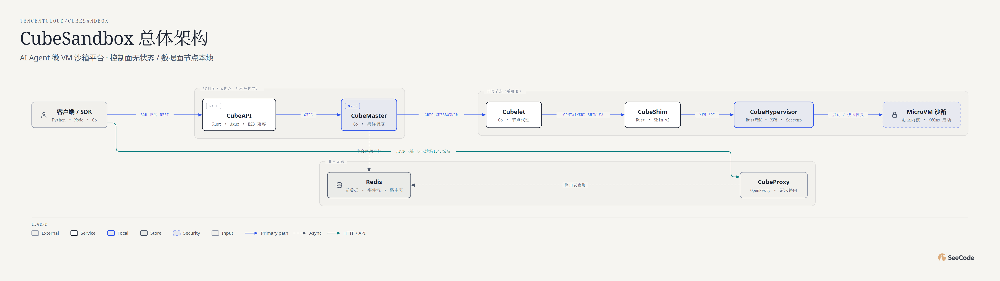

# TencentCloud CubeSandbox · 47 图全方位分析

用 **45 种核心图表类型 + 2 种变体（共 47 张）** 对 [TencentCloud/CubeSandbox](https://github.com/TencentCloud/CubeSandbox) 的全景解读。

**👉 在线浏览：<https://ruijh.github.io/seecode-analysis/projects/cubesandbox-analysis/docs/index.html>**（每张图都是可交互 HTML：悬停、动画回放、镜头追踪）

## 一图速览



| 指标 | 数值（2026-11-01 采集） |
|---|---|
| GitHub Stars / Forks | 13,112 / 1,191 |
| 源文件 | 3,987（Go 1578 · Rust 403 · Python 216 · TS 102） |
| 冷启动延迟 | 41.0ms（1 并发）→ 92.4ms 均值（50 并发，裸金属实测） |
| 单节点密度 | 500 台存活沙箱，每 VM 摊销 ~24.6MiB 内存 |
| 最新版本 | v0.7.3（2026-10-12），CNCF Landscape 已收录 |

## 项目一句话

CubeSandbox 是腾讯云开源的 AI Agent 安全沙箱服务：基于 RustVMM + KVM 为每个沙箱启动一台硬件隔离的微 VM（独立内核），API 与 E2B 兼容——把模板的 rootfs + 内存快照 reflink 克隆后直接 restore，从而做到 <60ms 冷启动。

## 五个分析维度

| 维度 | 图表 | 回答的问题 |
|---|---|---|
| 系统结构 (10) | architecture×2、high-level、deployment、dependency、architecture-delta、it-state、uml-class、er、db-schema | 控制面（CubeAPI/Master/Ops + Redis/MySQL）与数据面（Cubelet/Shim/VMM）如何分工；CubeCoW 的 `trait Engine` 真实类图与 cubedb 真实表结构 |
| 流程过程 (12) | flowchart、sequence、state、swimlane、process、data-flow、journey、timeline、gantt、kanban、story-map、loop | 一次 `Sandbox.create()` 的 12 步旅程；模板四泳道锻造流程；AutoPause 状态机与密度飞轮；2026 年 16 个版本的发布节奏 |
| 数据平台 (3) | medallion、dp-integration、dp-security-matrix | 审计/指标遥测的分层加工；agent→Redis→CubeOps→WebUI 接入链路；凭据永远不进沙箱的访问矩阵 |
| 结构组织 (13) | tree、org-chart、nested、layers、isometric、exploded、isometric-plan、venn、pyramid、funnel、quadrant、fishbone、wardley | 把 MicroVM 画成实物（3D/爆炸图/平面图）；隔离金字塔与技术选型 2×2；并发冷启动劣化的根因假设 |
| 数据图表 (9) | bar、line、scatter、waterfall、treemap、heatmap、radar、polar、sankey | 全部基于 CubeBench v0.7.3 裸金属基准与实测代码统计：500 台压测的内存账本、模块×语言矩阵 |

## 数据与说明

- 数据来源：本地完整克隆（2026-11-01）、`docs/blog/posts/2026-10-28-cubebench-073.md` 性能基准、`pkgs/cubedb/migrate/` 迁移 SQL、`docs/guide/roadmap.md`、GitHub API。
- 图表 caption 中注明 **"分析性判断/作者观点"** 的（如 radar 评分、quadrant 定位、fishbone 根因假设）是基于文档结构的合理归纳，其余均为实测数据。
- `docs/` 下每张图有三个文件：`.html`（交互版）、`.png`（静态快照）、`.json`（SeeCode 图表规格，可复现/修改后重新渲染）。

## 复现

图表由 [SeeCode](https://github.com/) 引擎渲染；`docs/*.json` 即图表规格。修改后重新渲染：

```sh
SC render docs/01-architecture.json   # 输出同名 .html
SC export docs/01-architecture.html --formats png
```

## 相关链接

- 上游项目：<https://github.com/TencentCloud/CubeSandbox>
- 官方文档：<https://github.com/TencentCloud/CubeSandbox/blob/master/docs/index.md>
- 性能基准：`docs/blog/posts/2026-10-28-cubebench-073.md`（上游仓库内）
- 本分析索引页源文件：[`docs/index.html`](docs/index.html)
