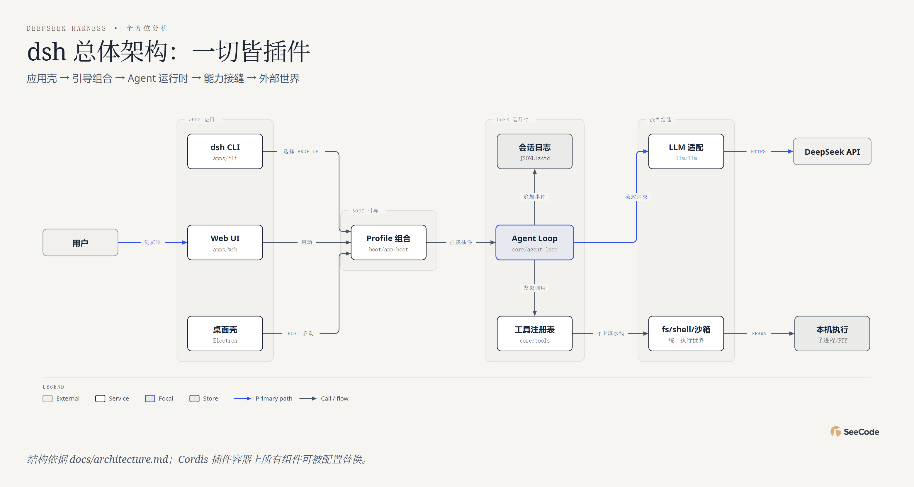

# DeepSeek Harness · 60 图全方位分析

用 **45 种核心图表类型 + 15 种变体（共 60 张）** 对 [deepseek-ai/deepseek-harness](https://github.com/deepseek-ai/deepseek-harness) 的全景解读。

**👉 在线浏览：<https://ruijh.github.io/seecode-analysis/projects/deepseek-harness-analysis/docs/index.html>**（每张图都是可交互 HTML：悬停、动画回放、镜头追踪）

## 一图速览



| 指标 | 数值（2026-10-31 采集） |
|---|---|
| GitHub Stars / Forks | 267,275 / 32,407 |
| 提交数（85 天） | 5,401（月度 267 → 1,984 → 3,150） |
| 已合并 PR / 贡献者 | 859 / 67 |
| packages 包数 | 372（client 69、experimental 65） |
| 代码行数 | 约 276 万（TypeScript 223 万、TSX 39.5 万） |
| 测试文件 | 2,020 个，CI 工作流 31 条 |

## 五个分析维度

| 维度 | 图表 | 回答的问题 |
|---|---|---|
| 系统结构 (10) | architecture、high-level×2、deployment、dependency、architecture-delta、it-state、uml-class、er、db-schema | "一切皆插件"的架构：应用壳 → Profile 组合 → Agent Loop → 能力接缝 → DeepSeek API |
| 流程过程 (15) | flowchart、sequence×2、state×2、swimlane、process、data-flow、journey、timeline、gantt、kanban、story-map、loop×2 | 一次对话回合怎么流转、工具如何经守卫流水线进沙箱、开发节奏如何演进 |
| 数据平台 (3) | medallion、dp-integration、dp-security-matrix | 会话日志（JSONL+zstd）→ 投影 → 消费的分层；五类角色的权限矩阵 |
| 结构组织 (15) | tree×2、org-chart、nested、layers、isometric×3、venn、pyramid、funnel、quadrant×2、fishbone、wardley | 把 372 个包画成园区/组织/实物；信任域嵌套；兼容性破坏的根因 |
| 数据图表 (17) | bar、line、scatter、waterfall、treemap、heatmap、radar、polar、sankey + dumbbell、marimekko、slopegraph、bump、streamgraph、ridgeline、bubble、beeswarm | 全部基于真实 git/LOC 数据：周提交峰值 1,376、client 域 41 万行最大、15 点提交高峰 |

## 数据与说明

- 数据来源：本地完整克隆（2026-10-31）的 git 历史、LOC 扫描、全部 `package.json`、`docs/` 架构文档、GitHub API。
- 图表 caption 中注明 **"分析性判断/推断"** 的（如 radar 评分、swimlane 审批流、sequence-oauth 登录时序）是基于文档结构的合理归纳，其余均为实测数据。
- `docs/` 下每张图有三个文件：`.html`（交互版）、`.png`（静态快照）、`.json`（SeeCode 图表规格，可复现/修改后重新渲染）。

## 复现

图表由 [SeeCode](https://github.com/) 引擎渲染；`docs/*.json` 即图表规格。修改后重新渲染：

```sh
SC render docs/01-architecture.json   # 输出同名 .html
SC export docs/01-architecture.html --formats png
```

## 相关链接

- 上游项目：<https://github.com/deepseek-ai/deepseek-harness>
- 官方文档：<https://deepseek-harness.github.io/deepseek-harness/>
- 本分析索引页源文件：[`docs/index.html`](docs/index.html)
