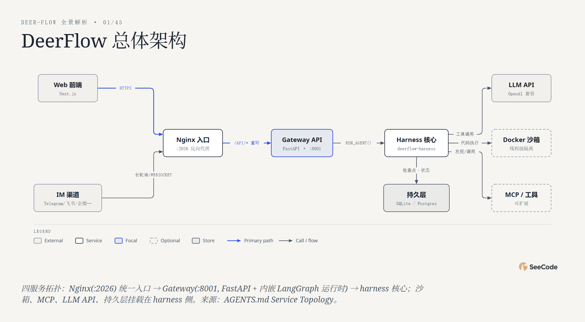

# DeerFlow · 45 图全方位分析

用 **45 种图表类型** 对 [bytedance/deer-flow](https://github.com/bytedance/deer-flow) 的全景解读。

**👉 在线浏览：<https://ruijh.github.io/seecode-analysis/projects/deer-flow-analysis/docs/index.html>**（每张图都是可交互 HTML：悬停、动画回放、镜头追踪）

## 一图速览



| 指标 | 数值（2026-10-31 采集） |
|---|---|
| GitHub Stars / Forks | 84,762 / 11,895 |
| 提交数（近 52 周） | 4,093（峰值月：2026-10 共 1,460 次） |
| 仓库文件 | 4,430（Python 2,557 · TS/TSX 1,050 · MD/MDX 455） |
| 当前版本 | v2.2.0（2026-10-29） |
| 语言构成 | Python 37.0 MB（82%）· TypeScript 6.4 MB（14%） |
| 官方技能 / IM 渠道 | 23 / 9 |

## 五个分析维度

| 维度 | 图表 | 回答的问题 |
|---|---|---|
| 系统结构 (9) | architecture、high-level、deployment、dependency、architecture-delta、it-state、uml-class、er、db-schema | 四服务拓扑（Nginx → Gateway → harness → 沙箱）；"app 不许反向 import harness"的 CI 铁律；v1→v2 彻底重写前后对比 |
| 流程过程 (12) | flowchart、sequence、state、swimlane、process、data-flow、journey、timeline、gantt、kanban、story-map、loop | Agent 主循环怎么决策、一次研究运行从提问到 SSE 交付的 12 步、定时任务的租约状态机、子代理如何分工 |
| 数据平台 (3) | medallion、dp-integration、dp-security-matrix | 对话资产的 Bronze→Silver→Gold 分层；RAGFlow/WeKnora/LightRAG 统一引用契约；角色×数据访问矩阵 |
| 结构组织 (12) | tree、org-chart、nested、layers、isometric、exploded、isometric-plan、venn、pyramid、quadrant、fishbone、wardley | 仓库画成目录树/园区/拆解图；长任务翻车的四类根因；harness 在 Wardley 图上正从定制向产品移动 |
| 数据图表 (9) | bar、line、scatter、waterfall、treemap、heatmap、radar、polar、sankey | 全部基于真实数据：52 周 4,093 次提交、Python 占 82%、config 被 517 个测试引用、测试文件占 Python 文件一半以上 |

## 数据与说明

- 数据来源：本地克隆（2026-10-31）的文件实测（`git ls-files`、按目录/扩展名统计）、GitHub REST API（仓库统计、contributors、participation、languages）、README / AGENTS.md / CHANGELOG 原文。
- 图表 caption 中注明"主观评分"的（如 radar 能力画像）是基于文档结构的分析性判断，其余均为实测数据；折线/极坐标的月度聚合为 52 周数据按日历月近似归并（尾月并入 10 月）。
- `docs/` 下每张图有三个文件：`.html`（交互版）、`.png`（静态快照）、`.json`（SeeCode 图表规格，可复现/修改后重新渲染）。

## 复现

图表由 [SeeCode](https://github.com/) 引擎渲染；`docs/*.json` 即图表规格。修改后重新渲染：

```sh
SC render docs/01-architecture.json   # 输出同名 .html
SC export docs/01-architecture.html --formats png
```

## 相关链接

- 上游项目：<https://github.com/bytedance/deer-flow>
- 官方网站：<https://deerflow.tech>
- 本分析索引页源文件：[`docs/index.html`](docs/index.html)
- 同系列：[deepseek-harness-analysis](https://github.com/ruijh/deepseek-harness-analysis)
