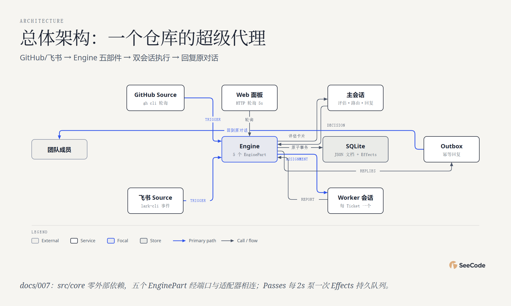

# dsh-superagent · 49 图全方位分析

用 **45 种核心图表类型 + 4 种变体（共 49 张）** 对 [deepseek-ai/dsh-superagent-prototype](https://github.com/deepseek-ai/dsh-superagent-prototype) 的全景解读。

**👉 在线浏览：<https://ruijh.github.io/seecode-analysis/projects/dsh-superagent-prototype-analysis/>**（每张图都是可交互 HTML：悬停、动画回放、镜头追踪）

**🎬 演示影片：<https://ruijh.github.io/seecode-analysis/projects/dsh-superagent-prototype-analysis/docs/demo.html>**（3 分 26 秒动画宣传片：重点图先动画讲结论、再放大展示原图，配 MiniMax 语音旁白与合成音效；`?t=秒` 可直达任意场景）

## 一图速览



| 指标 | 数值（2026-11-01 采集） |
|---|---|
| 项目定位 | DeepSeek Harness 的"超级代理"原型：监听 GitHub/飞书 → 策略授权 → 开 Ticket → Agent 会话执行 → 回复原对话 |
| 发布形态 | 单次 squash 提交（2026-10-31），研究原型、非官方产品 |
| 代码规模 | 约 3.3 万行：源码 15.0k + **测试 15.0k（1:1）** + 文档 2.0k |
| 直接依赖 | 仅 2 个第三方（proper-lockfile、zod）+ 24 个 @deepseek-ai/* peer 包 |
| 持久化 | orchestrator.sqlite：9 张表全是 JSON 文档（key/value），WAL + 单写者 |
| 提示词 | 15 个可版本化部件，效力五级排序（工具事实 > 内置段 > rules > 团队段 > 外部文本） |

## 五个分析维度

| 维度 | 图表 | 回答的问题 |
|---|---|---|
| 系统结构 (10) | architecture、high-level×2、deployment、dependency、architecture-delta、it-state、uml-class、er、db-schema | Source → Engine 五部件 → 双会话执行；bundle patch 如何挂进 DSH 宿主；JSON 文档仓储 |
| 流程过程 (15) | flowchart、sequence×2、state×2、swimlane、process、data-flow、journey、timeline、gantt、kanban、story-map、loop | 一条消息的六道准入闸、Ticket 生命周期（可被人的消息唤醒）、observe→auto 的 Policy 调优飞轮 |
| 数据平台 (3) | medallion、dp-integration、dp-security-matrix | 事件三层加工；主会话/worker/面板/Source 四主体的访问矩阵 |
| 结构组织 (15) | tree、org-chart、nested、layers、isometric×3、venn、pyramid、quadrant、fishbone、wardley | "一个主脑按单雇工"的会话组织；执行隔离嵌套；提示词效力金字塔；注意力浪费根因 |
| 数据图表 (10) | bar、line、scatter、waterfall、treemap、heatmap、radar、polar、sankey、funnel | 全部基于 wc -l/依赖实测：测试≈源码 1:1、文档厚度曲线、准入强度矩阵 |

## 关键发现

- **概念最少化落到类型上**：Ticket 宏观只有 open/ended 两态、终态五值（completed/merged/closed/dropped/stopped），阶段（person/working/idle…）是派生视图而非存储状态。
- **授权默认极保守**：admission 表默认 `unlistedAddressed: 'ignore'`——名单外的人 @它默认被无视，显式规则才放行；observe 模式只记 would-accept。
- **双会话分工**：常驻主会话（评估/路由/回复）+ 每 Ticket 一个 worker 会话（worktree 隔离、后台 30 分钟上限、槽位并发），人的追问随时可插入或唤醒已结束工单。
- **测试即规格**：tests 14960 行 ≈ 源码 15043 行，含 docs.spec 校验文档与实现一致。

## 数据与说明

- 数据来源：本地完整克隆（2026-11-01）的 `wc -l` 统计、package.json 依赖解析、docs/000-008 九篇编号文档与四路并行代码深读（file:line 见各 spec 的 evidence 字段）。
- 上游为**单次 squash 发布**（唯一提交 2026-10-31），无 git 历史，故无提交类时间序列图；timeline/gantt 的"内部孵化"区间为推断并在 caption 注明。
- 图表 caption 中注明 **"分析性判断/推断/示意"** 的（如 radar 评分、quadrant 定位、funnel 示意流量）为合理归纳，其余均为实测数据。

## 复现

图表由 SeeCode 引擎渲染；`docs/*.json` 即图表规格，`tools/gen49.mjs` 为批量生成器。修改后重新渲染：

```sh
node tools/gen49.mjs                    # 写入全部 spec 并渲染
SC export docs/01-architecture.html --formats png
```

## 相关链接

- 上游项目：<https://github.com/deepseek-ai/dsh-superagent-prototype>
- 姊妹分析：[deepseek-harness-analysis](https://github.com/ruijh/deepseek-harness-analysis)（dsh 内核本身）
- 分析合集索引：[seecode-analysis](https://ruijh.github.io/seecode-analysis/)
