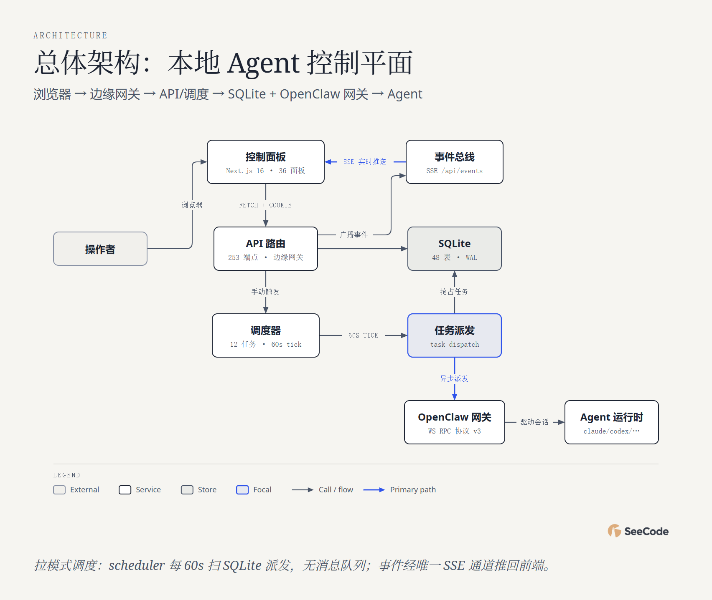

# Mission Control · 49 图全方位分析

用 **45 种核心图表类型 + 4 种变体（共 49 张）** 对 [builderz-labs/mission-control](https://github.com/builderz-labs/mission-control) 的全景解读。

**👉 在线浏览：<https://ruijh.github.io/seecode-analysis/projects/mission-control-analysis/docs/index.html>**（每张图都是可交互 HTML：悬停、动画回放、镜头追踪）

## 一图速览



| 指标 | 数值（2026-11-01 采集） |
|---|---|
| 项目定位 | 自托管的 AI Agent 控制平面（Next.js 16 + SQLite） |
| 提交数 / 贡献者 | 542（8 个月）/ 55 人（单人主导 ~81%） |
| 代码规模 | src 约 12.1 万行（lib 4.6 万 · components 4.3 万 · app 3.0 万） |
| API 表面 | 253 端点 / 144 路径（openapi v1.3.0，双向 parity 门禁） |
| 数据库 | SQLite 48 表，迁移 001–055 |
| 调度 | 12 个内建任务，60s tick 拉模式派发（无消息队列） |
| 质量设施 | 8 个 CI workflow（全 SHA 锚定）+ 248 个测试文件 + 20 个限速器 |

## 五个分析维度

| 维度 | 图表 | 回答的问题 |
|---|---|---|
| 系统结构 (10) | architecture、high-level×2、deployment、dependency、architecture-delta、it-state、uml-class、er、db-schema | 本地 Agent 控制平面：浏览器 → 边缘网关 → API/调度 → SQLite + OpenClaw 网关 → Agent 运行时 |
| 流程过程 (15) | flowchart、sequence×2、state×2、swimlane、process、data-flow、journey、timeline、gantt、kanban、story-map、loop | 一条 assigned 任务的四条出路、九态任务状态机、Aegis 质检回路、8 个月开发节奏 |
| 数据平台 (3) | medallion、dp-integration、dp-security-matrix | 运行数据三路消费；viewer/operator/admin/super/agent-key 五行权限矩阵 |
| 结构组织 (15) | tree、org-chart、nested、layers、isometric×3、venn、pyramid、quadrant、fishbone、wardley | Agent 编队当公司看；七层信任域嵌套；派发失败根因；编排生态战略坐标 |
| 数据图表 (10) | bar、line、scatter、waterfall、treemap、heatmap、radar、polar、sankey、funnel | 全部基于真实 git/openapi/wc 统计：月提交两次冲刺、542 提交作息钟、253 端点流向 |

## 关键发现

- **拉模式而非消息队列**：scheduler 每 60s 扫 SQLite，双派发防护靠条件 UPDATE 原子抢占（task-dispatch.ts:1767）。
- **四条派发出路**：Claude 基础会话 → 网关定向投递 → 直连 API（模型三级分派）→ 网关新会话；失败按 attempts≥5 熔断。
- **安全工程超配**：Ed25519 不可导出设备身份、nonce+strict-dynamic CSP、20 个限速器、审计三件套（security_events / trust_scores / mcp_call_log 签名回执）。
- **供应链自检**：config-integrity workflow 检测投毒特征，自实现的 action-pin 强制器要求全部 GitHub Actions 按 40 位 SHA 锚定。

## 数据与说明

- 数据来源：本地完整克隆（2026-11-01）的 git 历史、`wc -l` 行数统计、`openapi.json`（144 path / 253 operation 程序化解析）、四路并行代码深读（file:line 见各 spec 的 evidence 字段）。
- 图表 caption 中注明 **"分析性判断/推断"** 的（如 radar 评分、quadrant 定位、journey 情绪曲线）是基于代码证据的合理归纳，其余均为实测数据。
- `docs/` 下每张图有三个文件：`.html`（交互版）、`.png`（静态快照）、`.json`（SeeCode 图表规格，可复现/修改后重新渲染）。

## 复现

图表由 SeeCode 引擎渲染；`docs/*.json` 即图表规格，`tools/gen49.mjs` 为批量生成器。修改后重新渲染：

```sh
node tools/gen49.mjs                          # 写入全部 spec 并渲染
SC export docs/01-architecture.html --formats png
```

## 相关链接

- 上游项目：<https://github.com/builderz-labs/mission-control>
- 分析合集索引：[seecode-analysis](https://ruijh.github.io/seecode-analysis/)
