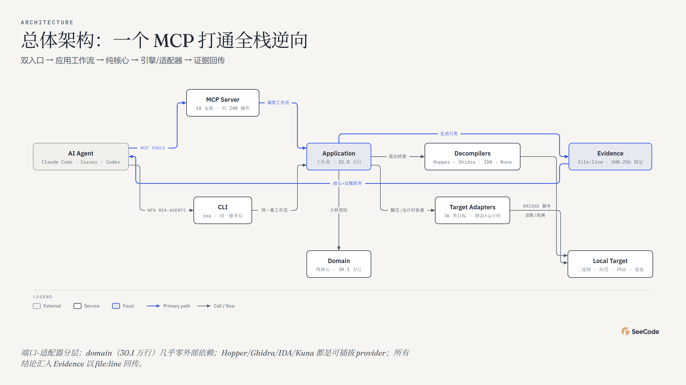

# REA · 49 图全方位分析

用 **45 种核心图表类型 + 4 种变体（共 49 张）** 对 [morluto/rea](https://github.com/morluto/rea)（Reverse Engineer Anything）的全景解读。

**👉 在线浏览：<https://ruijh.github.io/seecode-analysis/projects/rea-analysis/docs/index.html>**（每张图都是可交互 HTML：悬停、动画回放、镜头追踪）

## 一图速览



| 指标 | 数值（2026-11-01 采集） |
|---|---|
| 项目定位 | 一个 MCP 打通二进制/应用/运行时的逆向工程（TypeScript · Node 22+） |
| 提交数 / 贡献者 | 6,278（6.5 个月）/ 369 人（morluto ~61%） |
| 代码规模 | 全仓约 162 万行（src 93.6 万 · tests 58.4 万 · scripts+bridge 10.2 万） |
| MCP 表面 | 18 个工具家族 · 约 240 个操作（contracts 注册表统计，官方刻意不冻结数字） |
| 目标覆盖 | README 列 36 类目标（PE/ELF/GPU/IL2CPP/WASM/APK/网站/固件/pcap…） |
| 发布工程 | release-please · 39 个 tag（0.2.0→6.8.0 仅 3.5 个月） |
| 质量设施 | 33 个 CI workflow（含 24 个 real-* 真机/真工具矩阵）+ Stryker 变异测试 |

## 五个分析维度

| 维度 | 图表 | 回答的问题 |
|---|---|---|
| 系统结构 (10) | architecture、high-level×2、deployment、dependency、architecture-delta、it-state、uml-class、er、db-schema | 双入口（MCP+CLI）→ Application 工作流 → 30.1 万行纯核心 Domain；引擎外置的端口-适配器架构 |
| 流程过程 (14) | flowchart、sequence×2、state×2、swimlane、process、data-flow、journey、timeline、gantt、kanban、story-map、loop | 一次调查的决策树、MCP 调用时序、载荷检查状态机（complete/partial/unexamined）、0.2.0→6.8.0 发布史 |
| 数据平台 (3) | medallion、dp-integration、dp-security-matrix | 目标字节的三层加工；五种来源域汇入统一证据平台；六类分析的副作用矩阵 |
| 结构组织 (12) | tree、org-chart、nested、layers、isometric×3、venn、pyramid、quadrant、fishbone、wardley | 仓库目录树；逆向事务所角色；分析边界嵌套；证据可信度七层；36 类目标的依赖金字塔 |
| 数据图表 (10) | bar、line、scatter、waterfall、treemap、heatmap、radar、polar、sankey、funnel | 全部基于真实 git/find/SC scan 统计：tests 58.4 万行居首、周六 0-3 点提交 406 次、凌晨提交占 34% |

## 关键发现

- **测试比大多数项目整个仓库还厚**：tests 2158 个文件 58.4 万行，对比 src 93.6 万行；Stryker 变异测试有独立 CI workflow，`tsconfig.reverse-tools-mutation.json` 等四套 tsconfig 服务不同质量门禁。
- **证据是一等公民**：每个结论携带 file:line / 容器内坐标 / SHA-256 锚定；输入文件变更即拒绝解析；未选中的载荷永远保持 `not-selected`，覆盖度只有 complete/partial/unexamined 三种诚实表述。
- **引擎外置的端口-适配器**：Domain 核心近零依赖（仅 contracts），Hopper/Ghidra/IDA/Kuna/JEB/Cutter 都是可插拔 provider（`bridge/` 下 Python 脚本），新增目标只需加 adapter——36 类目标里 17 类零依赖。
- **预算即契约**：单活跃 inspection、512 MiB 载荷工作量、16 MiB 保留事实、1 MiB 单页响应，超限显式拒绝而非静默截断；"资源预算漏斗"（49-funnel）画出了这套嵌套上限。
- **发布机器**：release-please 驱动 39 个 tag，0.x→6.8.0 只用 3.5 个月；CHANGELOG 显示破坏性变更逐条致谢外部贡献者。
- **深夜周末的全球协作**：369 位贡献者，周六凌晨 0-3 点一档 406 次提交为全图峰值，README 翻译成 23 种语言。

## 数据与说明

- 数据来源：本地完整克隆（2026-11-01）的完整 git 历史（6278 提交）、`find+cat` 行数统计、SC scan 目录级 import 矩阵、`package.json`/`server.json`/`CHANGELOG.md` 与 `docs/`（98 篇）深读（file:line 见各 spec 的 evidence 字段）。
- git 作者日期受 squash 合流与历史导入影响高度集中于 2026-10（5459/6278）；tag 的 creatordate（0.2.0=07-12 → 6.8.0=10-25）更接近真实发布节奏，timeline/gantt 均以 tag 时间为准。
- MCP 工具操作数按 `src/contracts/*ToolContracts.ts` 中注册的 snake_case 操作名统计（约 240）；官方文档刻意不冻结工具数，目录以运行时 `tools/list` 为准。
- 图表 caption 中注明 **"分析性判断/推断"** 的（如 radar 评分、quadrant 定位、journey 情绪曲线）是基于代码证据的合理归纳，其余均为实测数据。
- `docs/` 下每张图有三个文件：`.html`（交互版）、`.png`（静态快照）、`.json`（SeeCode 图表规格，可复现/修改后重新渲染）。

## 复现

图表由 SeeCode 引擎渲染；`docs/*.json` 即图表规格，`tools/gen49.mjs` 为批量生成器（渲染 + PNG 导出一步完成）。修改后重新生成：

```sh
node tools/gen49.mjs        # 写入全部 spec 并渲染、导出 PNG
node tools/gen-index.mjs    # 重新生成画廊页 docs/index.html
```

## 相关链接

- 上游项目：<https://github.com/morluto/rea>
- 分析合集索引：[seecode-analysis](https://ruijh.github.io/seecode-analysis/)
